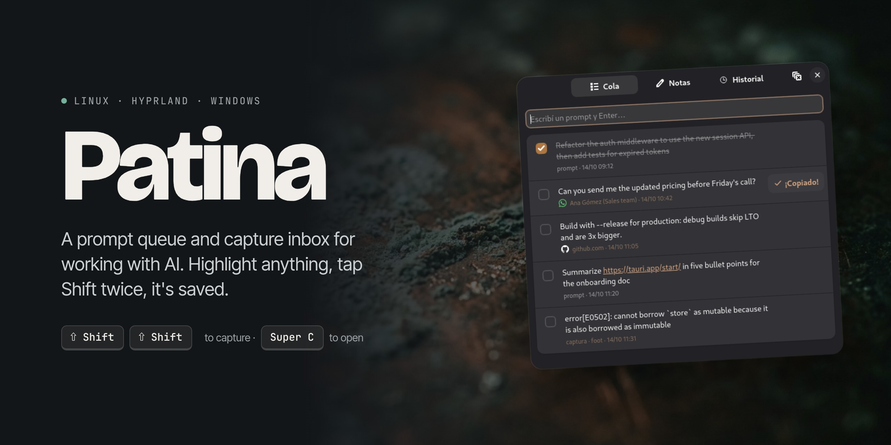
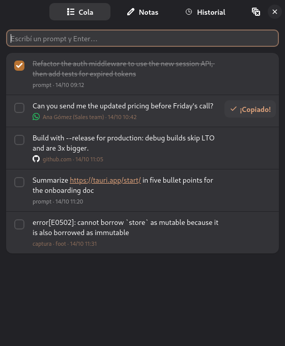
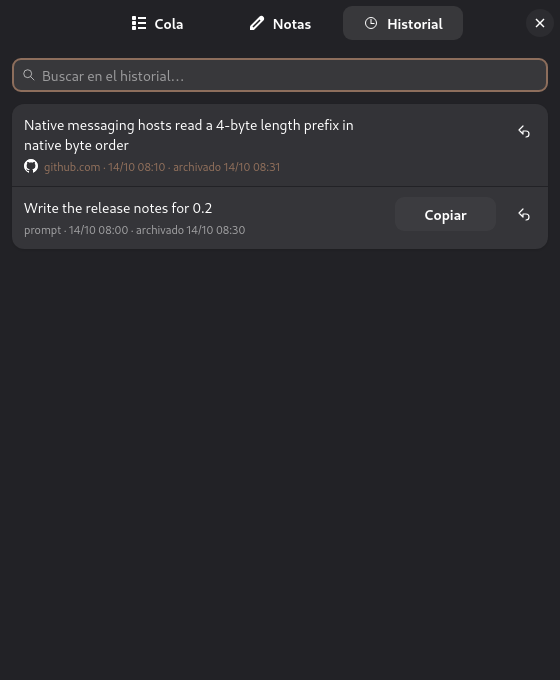

<p align="center">
  
</p>

<p align="center">
  <a href="https://github.com/lautarosegura/patina/actions/workflows/ci.yml"></a>
  
  
  
  <a href="LICENSE"></a>
</p>

<p align="center">
  <b>Highlight text in any app, tap <kbd>Shift</kbd> <kbd>Shift</kbd>, and it's saved.</b><br>
  A prompt queue, capture inbox and scratchpad for AI-assisted work.<br>
  Everything stays on your machine: no sync, no telemetry, no account.
</p>

<p align="center">
  <a href="#install-on-linux">Linux</a> ·
  <a href="#install-on-windows">Windows</a> ·
  <a href="#install-the-browser-extension-optional">Browser extension</a> ·
  <a href="#shortcuts">Shortcuts</a> ·
  <a href="#build-from-source">Build from source</a>
</p>

<table align="center">
  <tr>
    <td></td>
    <td></td>
  </tr>
  <tr>
    <td align="center"><sub>The queue, with captures from WhatsApp Web, GitHub and a terminal</sub></td>
    <td align="center"><sub>History keeps what you cleared</sub></td>
  </tr>
</table>

> [!NOTE]
> Patina is inspired by [Copper](https://shadcn.com/copper), shadcn's macOS app. It is an independent project with no affiliation with Copper or its author. If you're on a Mac, buy Copper.
>
> The interface is currently in Spanish.

## Features

- **Double Shift capture.** Saves the highlighted text with the app it came from and the time. Patina won't capture the same selection twice. On Linux, a selection made more than 10 seconds ago doesn't count either, because Wayland keeps it available after nothing looks selected on screen.
- **Queue.** Type prompts and copy them with Enter. Links open with a click, and every item has a **Copiar** button.
- **Notes.** A scratchpad that saves itself.
- **History.** Items you clear or delete from the queue are kept, searchable, and can be restored.
- **Browser extension** (Brave, Chrome, Chromium or Edge):
  - A capture remembers its page: favicon, domain, title, and a link back to it.
  - With no fresh selection in the browser, Patina captures the active tab's URL. This also covers the address bar.
  - On WhatsApp Web, a capture keeps the sender, the group and when the message was sent.
  - Text is saved as it looks on screen. Chromium breaks lines around inline elements such as X mentions, and Patina undoes that.

## Platforms

| Platform | Status |
| --- | --- |
| Linux, Hyprland 0.55+ with `hyprland.lua` | ✅ Tested on 0.56 |
| Linux, Hyprland 0.53+ with `hyprland.conf` | ✅ Config checked with `Hyprland --verify-config` on 0.56 |
| Linux, Hyprland 0.48–0.52 | 🟡 Config written from the official docs for those versions, untested |
| Linux, Hyprland 0.47 and older | 🟡 Config written from the official docs (`windowrulev2`), untested |
| Linux, other compositors | ❌ Not supported. Patina uses `hyprctl` to read the active window and Hyprland binds for the shortcuts |
| Windows 10 and 11 | 🟡 Builds and passes the logic tests; not yet tested on a real Windows machine |
| macOS | ❌ Not supported. Use [Copper](https://shadcn.com/copper) |

## Install on Linux

Download the package for your distribution from the [releases page](https://github.com/lautarosegura/patina/releases):

- **Fedora:** `sudo dnf install ./Patina-*.x86_64.rpm`
- **Debian, Ubuntu:** `sudo apt install ./Patina_*_amd64.deb`
- **Other distributions:** the `.AppImage`. Make it executable and keep it somewhere stable, because Hyprland and the browser launch it by path.

The packages pull in `wl-clipboard` and `libnotify`. The AppImage needs both installed.

### Hyprland

Add the file that matches your Hyprland version at the end of your config, then run `hyprctl reload`. The `.deb` and `.rpm` packages install these files in `/usr/lib/Patina/hypr/`; they are also in [`hypr/`](hypr/) in this repo.

| Your setup | Line to add |
| --- | --- |
| 0.55+ with `hyprland.lua` | `dofile("/usr/lib/Patina/hypr/patina.lua")` |
| 0.53+ with `hyprland.conf` | `source = /usr/lib/Patina/hypr/patina.conf` |
| 0.48–0.52 | `source = /usr/lib/Patina/hypr/patina-0.48.conf` |
| 0.47 and older | `source = /usr/lib/Patina/hypr/patina-0.47.conf` |

This adds double Shift capture, <kbd>Super</kbd>+<kbd>C</kbd> to show or hide Patina, a floating window rule, and autostart on login.

The files run `patina` from Hyprland's `PATH`. That works with the packages, which install to `/usr/bin`. With the AppImage, or a binary in a folder outside Hyprland's `PATH` (often `~/.local/bin`), set the path first:

```lua
PATINA_BIN = "/home/you/Applications/Patina.AppImage"
dofile("/path/to/patina.lua")
```

With a `.conf` file, copy it and replace `patina` with the full path.

## Install on Windows

1. Download `Patina_*_x64-setup.exe` from the [releases page](https://github.com/lautarosegura/patina/releases) and run it. It installs for your user only and doesn't need admin rights.
2. Open Patina from the Start menu once. From then on it starts with Windows and stays in the tray.

On Windows:

- **Double Shift** captures the highlighted text. Windows has no "primary selection" like Linux, so Patina sends <kbd>Ctrl</kbd>+<kbd>C</kbd> to the focused app and then puts your clipboard back. Plain text and images come back; formatting such as HTML or RTF and copied files are lost. Some apps copy the whole line on <kbd>Ctrl</kbd>+<kbd>C</kbd> when nothing is selected (VS Code does), so a capture with nothing selected can save that line. Capturing the same text twice in a row does nothing, as on Linux.
- <kbd>Win</kbd>+<kbd>C</kbd> shows or hides Patina. If Windows reserves it (some versions open Copilot with it), Patina uses <kbd>Ctrl</kbd>+<kbd>Alt</kbd>+<kbd>C</kbd> instead.
- **The tray icon** shows or hides Patina on click and has a menu to quit.
- You can turn off starting with Windows in **Settings → Apps → Startup**. Patina won't turn it back on.

## Install the browser extension (optional)

The extension tells Patina which page a capture came from and, on WhatsApp Web, who sent the message. Patina registers its side of the connection with Brave, Chrome, Chromium and Edge every time it starts.

1. Open `brave://extensions`, `chrome://extensions` or `edge://extensions`.
2. Turn on **Developer mode**.
3. Click **Load unpacked** and pick the extension folder:
   - `.deb` or `.rpm`: `/usr/lib/Patina/extension`
   - Windows: `%LOCALAPPDATA%\Patina\extension`
   - AppImage or source: the [`extension/`](extension/) folder of this repo
4. Reload the tabs you already had open.

The extension asks for:

- **Read site data**, to know which page the highlighted text comes from.
- **Tabs**, shown by the browser as "read your browsing history", to get the active tab's URL and title.
- **Favicons**, to read the icons the browser already has cached, without fetching them.
- **Native messaging**, to hand the data to Patina.

## Shortcuts

| Action | Shortcut |
| --- | --- |
| Capture the highlighted text | <kbd>Shift</kbd> twice (within 350 ms) |
| Show or hide Patina | <kbd>Super</kbd>+<kbd>C</kbd> on Linux, <kbd>Win</kbd>+<kbd>C</kbd> or <kbd>Ctrl</kbd>+<kbd>Alt</kbd>+<kbd>C</kbd> on Windows |
| Add a prompt | Type in the field and press <kbd>Enter</kbd> |
| Move from the field to the list | <kbd>↓</kbd> or <kbd>Tab</kbd> |
| Copy and go back to the previous app | <kbd>Enter</kbd>, <kbd>Ctrl</kbd>+<kbd>C</kbd> or double-click on an item |
| Copy only | **Copiar** button shown on hover |
| Check or uncheck | Checkbox or <kbd>Space</kbd> |
| Open a link or the source page | Click the link or the domain |
| Delete (moves to history) | <kbd>Delete</kbd> or <kbd>Backspace</kbd> |
| Reorder | <kbd>Ctrl</kbd>+<kbd>↑</kbd> / <kbd>Ctrl</kbd>+<kbd>↓</kbd> |
| Clear checked items (moves them to history) | <kbd>Ctrl</kbd>+<kbd>Shift</kbd>+<kbd>Backspace</kbd> |
| Queue / Notes / History | <kbd>Ctrl</kbd>+<kbd>1</kbd> / <kbd>Ctrl</kbd>+<kbd>2</kbd> / <kbd>Ctrl</kbd>+<kbd>3</kbd> |
| History: restore to the queue | <kbd>Ctrl</kbd>+<kbd>Z</kbd> or the ↶ button |
| History: delete forever | <kbd>Delete</kbd> |
| Hide | <kbd>Esc</kbd> |

From a terminal, `patina add "text"` adds a prompt and `patina capture` captures the current selection.

## Where your data lives

| | Linux | Windows |
| --- | --- | --- |
| Queue, history, notes, favicons | `~/.local/share/patina/` | `%APPDATA%\patina\` |
| Latest selection and active tab from the extension | `$XDG_RUNTIME_DIR/patina-*.json` (in memory, `0600`) | `%TEMP%\patina\` |

The files are `items.json` (the queue), `historial.json` (history), `notas.md` (notes) and `favicons/`. Patina 0.1, the Python version, used the same files, so updating keeps your data.

## How it works

Patina is a [Tauri](https://tauri.app) app: a Rust backend in [`src-tauri/`](src-tauri/) and a plain HTML, CSS and JavaScript interface in [`ui/`](ui/). One instance keeps running with its window hidden. Running `patina` again, with or without a command, hands the command to that instance.

The executable has three modes, picked from its arguments before Tauri starts:

- **`patina tap`** (Linux). Hyprland runs it on every Shift release without consuming the key. It doesn't start Tauri, so it stays cheap. Two taps within 350 ms run `patina capture`.
- **`patina chrome-extension://…`**. The browser starts this as the extension's native messaging host. It writes the latest selection and active tab to the runtime folder.
- **Anything else** starts the app or forwards to the running one.

The capture logic in [`src-tauri/src/logic.rs`](src-tauri/src/logic.rs) is the same on both platforms. What differs lives in [`src-tauri/src/platform/`](src-tauri/src/platform/):

- **Linux** reads and watches the Wayland primary selection with `wl-paste`, copies with `wl-copy`, reads the active window with `hyprctl` and notifies with `notify-send`. On Wayland the primary selection stays available after nothing looks selected, so Patina watches its changes to tell fresh selections from stale ones.
- **Windows** detects double Shift with a low-level keyboard hook and copies the selection with a simulated <kbd>Ctrl</kbd>+<kbd>C</kbd>. It also registers the native messaging host in the registry, the global shortcut, the tray icon and autostart.

On Linux, Patina sets `WEBKIT_DISABLE_DMABUF_RENDERER=1` before starting WebKitGTK. Without it, the window crashes with "Error 71 (Protocol error)" on Wayland with NVIDIA drivers.

## Build from source

The build runs in a Fedora container, so the only thing you need installed is `podman`:

```sh
scripts/build.sh test      # Rust and interface tests
scripts/build.sh linux     # .deb, .rpm and AppImage
scripts/build.sh windows   # Windows installer, cross-compiled
```

The installers end up in `src-tauri/target/release/bundle/` and `src-tauri/target/x86_64-pc-windows-msvc/release/bundle/nsis/`. Pushing a `v*` tag builds the same installers on GitHub Actions and attaches them to a draft release.

### Tests

- `scripts/build.sh test` runs the Rust tests and the interface tests. Both check the port against [`tests/parity.json`](tests/parity.json), which came from running the Python version. [`scripts/parity/gen_fixtures.py`](scripts/parity/gen_fixtures.py) regenerates it.
- `scripts/in-container.sh scripts/e2e/run.sh` drives the real app in a headless Sway inside the container, with a virtual mouse and keyboard. It checks every action against the data files and the clipboard. It never touches your desktop. Screenshots end up in `scripts/e2e/out/`.
- `scripts/in-container.sh env SCRIPT=readme_shots.py scripts/e2e/run.sh` regenerates the screenshots in this README.
- `tests/ui/dev.html` loads the interface in a normal browser with a mock backend. Serve the repo root with `python3 -m http.server` and open `/tests/ui/dev.html`.

## Uninstall

Remove the package (`sudo dnf remove patina`, `sudo apt remove patina`, or **Settings → Apps** on Windows), the Patina line from your Hyprland config, and the extension. Patina also leaves the native messaging registration behind:

- Linux: `rm ~/.config/*/NativeMessagingHosts/io.github.lautarosegura.patina.json ~/.config/BraveSoftware/Brave-Browser/NativeMessagingHosts/io.github.lautarosegura.patina.json`
- Windows: the `io.github.lautarosegura.patina` keys under `HKEY_CURRENT_USER\Software\<browser>\NativeMessagingHosts`

To delete your data too, remove the data folder listed above.

## License

[MIT](LICENSE). The WhatsApp logo comes from [Simple Icons](https://simpleicons.org) (CC0).
